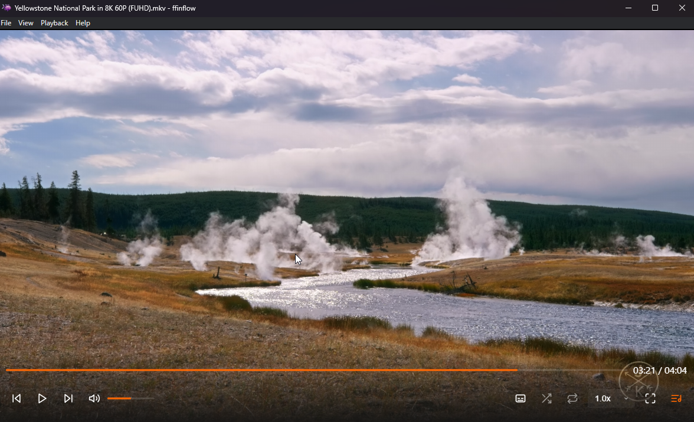

<div align="center">
  
  <br/>
  

  <br/><br/>

  <a href="https://github.com/skonester/ffinflow/releases/latest"></a>
  <a href="https://github.com/skonester/ffinflow/releases/latest"></a>
  <a href="LICENSE"></a>
  <a href="https://github.com/skonester/ffinflow/releases"></a>

  <br/><br/>

  
  <a href="https://github.com/skonester/ffinflow/releases">
    
  </a>
  <a href="https://github.com/skonester/ffinflow/releases">
    
  </a>

</div>

# ffinflow

A desktop media player and downloader for **Windows and Linux**, built with Electron and FFmpeg. Familiar menus and bottom playback controls keep the interface simple, while the bundled media tools prepare incompatible files for playback.

> Independent open-source project. Not affiliated with Microsoft or Windows Media Player — just inspired by that simple, no-gestures-required layout.

---

### 🚀 Features

- Windows installer and Linux x86_64 Flatpak releases
- Traditional menus and bottom playback controls that auto-hide when inactive, including in fullscreen
- Automatic media preparation: remux compatible streams, convert unsupported audio, or re-encode video when needed
- Compatible video is kept without re-encoding wherever possible, and audio channel counts are preserved
- Drag-and-drop playlist with shuffle, repeat, and reordering
- External and embedded subtitle support
- Media info overlay (codec, resolution, bitrate, audio/subtitle tracks)
- 18 built-in visual themes, with **Tokyo Night** as the default
- Remembers playback position, volume, and playlist between sessions
- **Convert Media** for video and audio exports, including H.264 and AV1 video
- Built-in yt-dlp downloader: open the download icon in the bottom controls or **File → Download Media...**, choose video/audio options, track progress, pause or resume jobs, and browse downloaded files
- Optional video/audio file associations in the Windows installer

### 📥 Installation

Download the asset for your platform from [GitHub Releases](https://github.com/skonester/ffinflow/releases):

| Platform | Package |
| :--- | :--- |
| Windows, 64-bit | `ffinflow Setup VERSION.exe` |
| Linux, x86_64 | `ffinflow-VERSION-x86_64.flatpak` |

The release packages include FFmpeg, FFprobe, and yt-dlp. You do not need a separate Node.js or FFmpeg installation to use the player.

#### Windows

Run the `.exe` installer. You can choose the installation directory and which video/audio file types ffinflow offers to open. Use Windows **Default apps** to choose it as your default player.

#### Linux (Flatpak)

Install Flatpak using the [setup instructions for your distribution](https://flatpak.org/setup/), then download the `.flatpak` bundle from GitHub Releases. Flathub supplies the shared runtime used by the app.

From the directory containing the downloaded bundle, replace `VERSION` with the downloaded release's version:

```bash
flatpak remote-add --user --if-not-exists flathub https://dl.flathub.org/repo/flathub.flatpakrepo
flatpak install --user --or-update --bundle "./ffinflow-VERSION-x86_64.flatpak"
flatpak run com.ffinflow.mediaplayer
```

After installation, ffinflow is also available from your desktop's application launcher. The first install may download the required shared runtime. To update a GitHub bundle installation, download the newer `.flatpak` and run the install command again with its filename. See the [Flatpak command reference](https://docs.flatpak.org/en/latest/flatpak-command-reference.html) for installation options.

The Flatpak package supports Wayland and X11 and has access to your home directory and the common removable-drive mount locations `/media`, `/run/media`, and `/mnt`.

### 🎞 Supported Formats

| Type | Extensions |
| :--- | :--- |
| Video | `.mp4` `.mkv` `.avi` `.webm` `.mov` `.flv` `.m4v` `.3gp` `.wmv` `.ts` |
| Audio | `.mp3` `.wav` `.ogg` `.aac` `.m4a` `.flac` `.wma` `.opus` |
| Subtitles | `.srt` `.vtt` `.ass` `.ssa` `.sub` |

Playback depends on the file's container, codecs, and the system's decoding capabilities. The bundled FFmpeg engine prepares incompatible files before playback. For example, E-AC3 or DTS audio can be converted while compatible HEVC video is retained.

Prepared files are saved **beside the original** as `<name>_FIXED.mp4`. If that name is occupied, a number is added. The original file is preserved, and validated conversions are reused when reopening it. A small `.ffinflow.json` sidecar records the conversion. The source directory must be writable when preparation is needed.

### ⌨️ Keyboard Shortcuts

| Key | Action | Key | Action |
| :--- | :--- | :--- | :--- |
| Space | Play / Pause | M | Mute / unmute |
| F | Toggle fullscreen | S | Toggle shuffle |
| Escape | Exit fullscreen | L | Toggle repeat |
| ←  / → | Seek ±10s | I | Toggle media info |
| Ctrl+← / Ctrl+→ | Previous / Next track | T | Toggle playlist |
| ↑ / ↓ | Volume up / down | 0-9 | Seek to 0%-90% |
| Ctrl+O | Open files | Ctrl+Shift+O | Open folder |
| Ctrl+Shift+D | Download media | Ctrl+Shift+V | Convert media |

### 🔧 Build from source

Use Node.js **26.13.1 LTS**, pinned in [.nvmrc](.nvmrc), for development and builds. Both release workflows use this file. With nvm, run `nvm install` and `nvm use` after cloning; with nvm-windows, pass `26.13.1` to both commands.

The current app uses **Electron 45.3.2**, which bundles **Node.js 24.22.2** for the shipped runtime. Development Node.js and Electron's embedded runtime are managed separately.

#### Windows build

Install Git with Git LFS and the Node.js version above. Git LFS retrieves the full Windows FFmpeg/FFprobe binaries tracked by this repository.

```powershell
git lfs install
git clone https://github.com/skonester/ffinflow.git
cd ffinflow
git lfs pull
npm ci
npm test
npm run build -- --publish never
```

The Windows installer is written to `dist/`. If the full binaries need to be fetched again, run `powershell -ExecutionPolicy Bypass -File .\fetch-ffmpeg.ps1` before building; the full build supplies encoders such as `libsvtav1` used by AV1 conversion.

#### Linux Flatpak build

Install Git, Node.js, `flatpak`, `flatpak-builder`, `curl`, `tar`, and `xz` using your distribution's packages. Install the runtime, SDK, and Electron BaseApp used by the current build configuration:

```bash
flatpak remote-add --if-not-exists flathub https://dl.flathub.org/repo/flathub.flatpakrepo
flatpak install flathub org.freedesktop.Platform//24.08 org.freedesktop.Sdk//24.08 org.electronjs.Electron2.BaseApp//24.08

GIT_LFS_SKIP_SMUDGE=1 git clone https://github.com/skonester/ffinflow.git
cd ffinflow
npm ci
bash fetch-linux-binaries.sh
npm run build -- --linux flatpak --x64 --publish never
```

The fetch script installs the Linux GPL FFmpeg/FFprobe binaries and a pinned yt-dlp binary, verifies their checksums, and removes Windows executables from the binary directories. The resulting `.flatpak` bundle is written to `dist/`.

To run the media tests on Linux after fetching the binaries:

```bash
FFINFLOW_FFMPEG="$PWD/ffmpeg-binaries/ffmpeg" \
FFINFLOW_FFPROBE="$PWD/ffmpeg-binaries/ffprobe" \
npm test
```

Run `npm start` to launch the development player after preparing the binaries for your platform.

The [Windows release workflow](.github/workflows/windows-release.yml) builds the installer. The [Linux release workflow](.github/workflows/linux-release.yml) builds and attaches the Flatpak after a successful manually triggered Windows release, or can be run independently. The Linux workflow also includes the container-specific setup used in CI.

### 📄 License

GNU General Public License v3.0 (or later). See [LICENSE](LICENSE).

Portions of the codebase remain available under their original MIT License —
see [LICENSE-MIT](LICENSE-MIT) — including the original player GUI, adapted
from [Fury](https://github.com/naveen-devang/Fury) (© Naveen Devang) prior to
ffinflow's transition to TypeScript, and the downloader engine
(`src/downloader/`, `src/modules/downloaderUI.ts`), adapted from
[dlME](https://github.com/YazeKT/dlME) (© Kirsten Trimaley). The built-in
downloader also bundles [yt-dlp](https://github.com/yt-dlp/yt-dlp) (Unlicense).
Clean titles and subtitle matching for release-style filenames use
[Parsium](https://github.com/NepiRaw/Parsium) (© NepiRaw, MIT).
